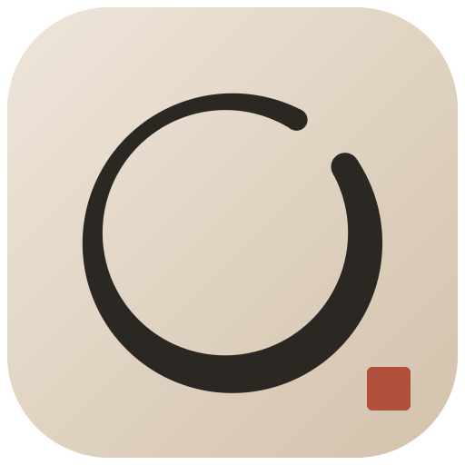
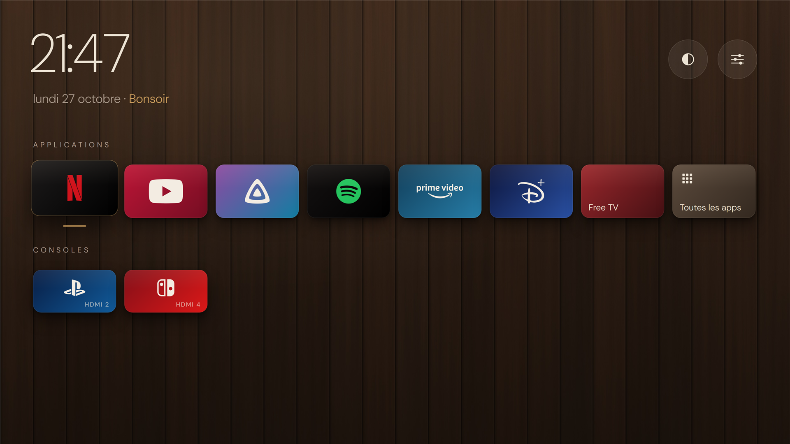
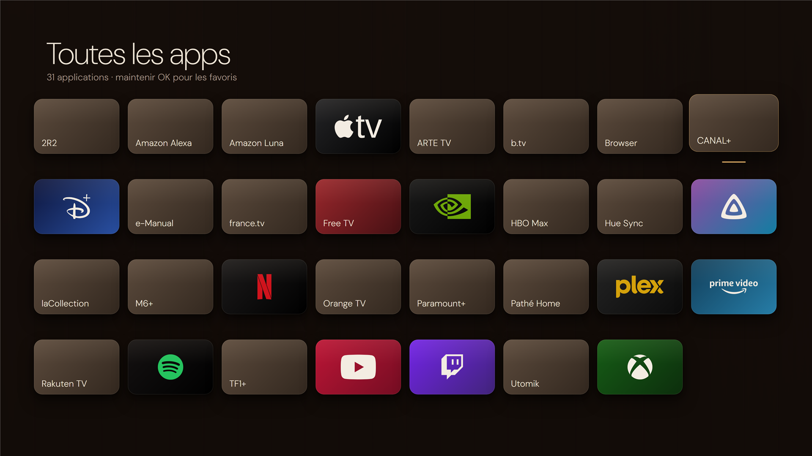
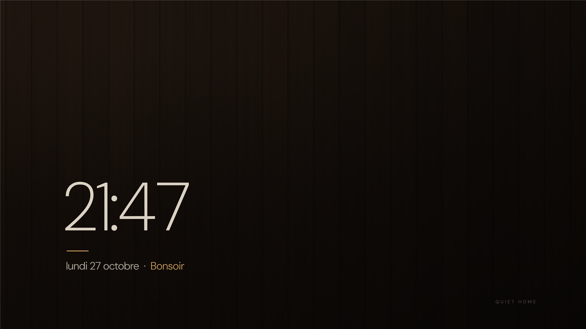

<p align="center"></p>

# Quiet Home pour Samsung Tizen

**Un écran d'accueil natif, calme et sans publicité pour les TV Samsung**, inspiré du design Japandi : mur de bois sombre, typographie fine, logos officiels des apps, consoles en un clic. Le **bouton Home de la télécommande y ramène directement**, sans root et sans modifier le système de la TV.



> Les images de ce README sont des **rendus** générés à partir des mêmes positions, couleurs, logos et polices que l'app (`native/tools/make_preview_kuri.py`). Ce ne sont pas des captures de la TV, que Tizen ne permet pas en mode développeur.

## Ce que fait Quiet Home

- **Accueil épuré** :
  - vos apps favorites avec leurs logos et couleurs officiels (Netflix, YouTube, Jellyfin, Spotify, Prime Video, Disney+…) ;
  - vos consoles en HDMI ;
  - l'heure, la date et une salutation.
- **Bouton Home → Quiet Home**, depuis n'importe quelle app, en moins d'une seconde. **Deux appuis rapides** ouvrent l'accueil Samsung : le Smart Hub et les paramètres restent toujours accessibles. Voir [docs/home-button.md](docs/home-button.md).
- **5 thèmes**, mémorisés :
  - Kuri (noyer) et Chêne fumé, avec un fond bois en 4K ;
  - Japandi, Sumi et Hinoki, en dégradés.
- **« Toutes les apps »** : une grille de toutes les apps installées ; maintenir OK sur une app l'ajoute aux favoris ou l'en retire.
- **Écran de veille** après 5 minutes : grande heure fine sur le bois voilé, avec un léger déplacement chaque minute pour protéger la dalle.
- **Télécommande** :
  - flèches, OK, OK maintenu pour les options ;
  - touches 1 à 9 pour lancer les favoris ;
  - transitions animées.
- **Récupération toujours accessible** : accueil Samsung, paramètres TV, réinitialisation, diagnostic (tests HDMI et volume, identification des touches).

| Toutes les apps | Écran de veille |
|---|---|
|  |  |

## Principes

- **Une app normale** (`.tpk` signé avec votre propre certificat Samsung), installée en mode développeur. Pas de root, pas de faille, aucune réécriture de réglages système.
- **Réversible** : désinstaller l'app remet la TV exactement dans son état d'origine.
- **Aucune donnée envoyée sur Internet.** Le seul trafic réseau est l'envoi des logs au PC de développement, sur le réseau local, et seulement quand le mode développeur est actif.

## Compatibilité

| | |
|---|---|
| Testé sur | **Samsung QE65QN700BTXXC** (Neo QLED 8K, 2022), Tizen 6.5 (API 9), armv7 |
| Probablement compatible | TV Samsung 2020 et plus récentes avec runtime .NET (Tizen 5.5+). **Non testé** : vos retours sont bienvenus. |
| PC de développement | Windows (scripts PowerShell). Tizen Studio, .NET 8 SDK et Python 3. Chrome sert seulement à régénérer les images. |

Le shell `sdb` des TV grand public récentes est fermé (même `echo` est refusé). Quiet Home ne s'en sert pas : tout passe par l'installation de l'app et par les API publiques de Tizen.

## Installer

Deux façons de faire :

1. **À la main** : suivez [docs/install.md](docs/install.md) (environ 30 minutes la première fois).
2. **Avec un agent de code** (Claude Code, Codex…) : ouvrez le dépôt, donnez-lui le prompt de [docs/agent.md](docs/agent.md), et faites vous-même les quelques gestes qu'il ne peut pas faire (compte Samsung, pare-feu, télécommande). Les consignes pour l'agent sont dans [AGENTS.md](AGENTS.md).

En résumé, une fois la TV en mode développeur et le certificat Samsung créé :

```powershell
.\native\tools\tv-native.ps1 -TvIp <IP_DE_LA_TV> -Action deploy -CertProfile <VOTRE_PROFIL>
```

## Documentation

| | |
|---|---|
| [docs/install.md](docs/install.md) | Installation pas à pas, démarrage automatique, logs |
| [docs/agent.md](docs/agent.md) | Faire l'installation et les réglages avec un agent |
| [docs/home-button.md](docs/home-button.md) | Le raccourci bouton Home : fonctionnement, limites, désactivation |
| [docs/customize.md](docs/customize.md) | Favoris, consoles HDMI, logos, thèmes, fonds, polices |
| [docs/troubleshooting.md](docs/troubleshooting.md) | Dépannage et retour à l'état d'origine |
| [native/README.md](native/README.md) | Référence technique : architecture, plan de tests |
| [docs/research/](docs/research/) | Recherche initiale (quiet-tizen, Fresh Home, Skylight…) |
| [web/](web/) | Premier prototype en Web App (historique) |

## Arborescence

```
native/
  src/QuietHome.Core/      logique pure (config, catalogue, focus, thèmes, bouton Home), testée sur PC
  src/QuietHome.Launcher/  app NUI : écran d'accueil, grille, veille, plateforme Tizen
  tests/                   tests xUnit (dotnet test)
  res/                     logos, pictogrammes, fonds 4K, polices (prêts à l'emploi)
  tools/                   build/signature/installation, génération des ressources et des rendus
tools/tv-fiche.ps1         fiche technique de votre TV (lecture seule)
docs/                      documentation et images
web/                       prototype Web App (historique)
```

## Remerciements et inspiration

- [jss8649/quiet-tizen](https://github.com/jss8649/quiet-tizen) : l'idée d'un launcher natif .NET/NUI et les mécanismes natifs (sources, volume, paramètres).
- [NelsonEU/arn0-tv](https://github.com/NelsonEU/arn0-tv) : les sources des logos et les couleurs des marques.
- [SaudSatopay/skylight-tizen](https://github.com/SaudSatopay/skylight-tizen) : l'idée de revenir au launcher en observant l'écran plutôt qu'en interceptant la touche.
- [KSWORK2001/fresh-home](https://github.com/KSWORK2001/fresh-home), [gus-cardoso/quiet-tizen-qn90b](https://github.com/gus-cardoso/quiet-tizen-qn90b), [simbasjungles/free-my-tv](https://github.com/simbasjungles/free-my-tv).

## Licence

Code sous licence [MIT](LICENSE). Logos, polices et autres éléments tiers : voir [NOTICE.md](NOTICE.md). Les noms et logos de marques appartiennent à leurs propriétaires. Ce projet n'est affilié ni à Samsung ni aux services cités.
