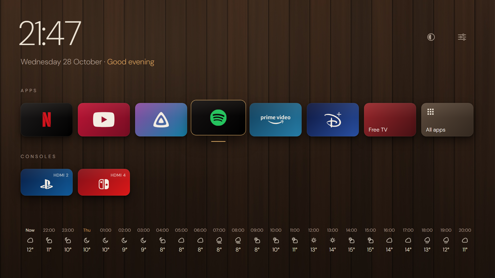
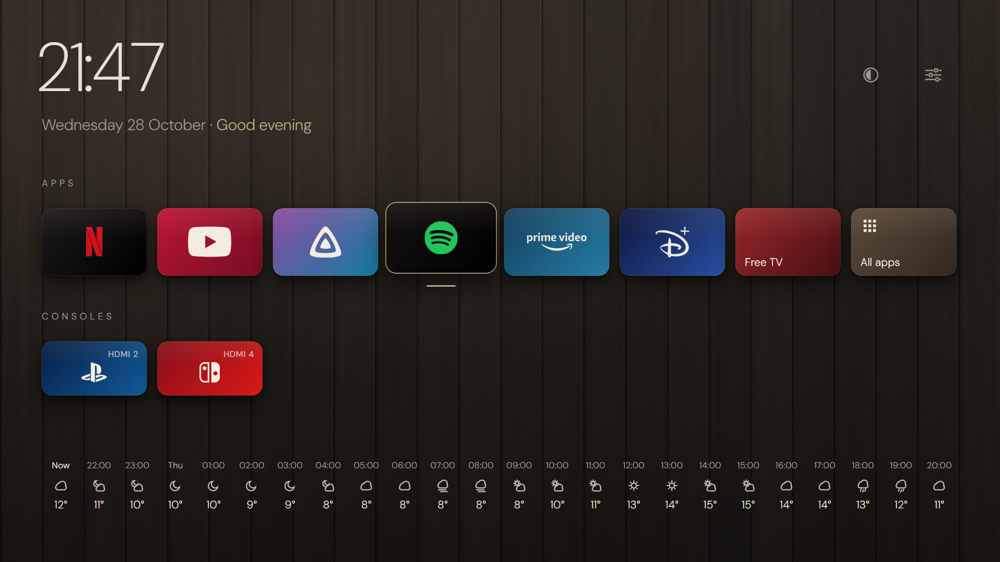
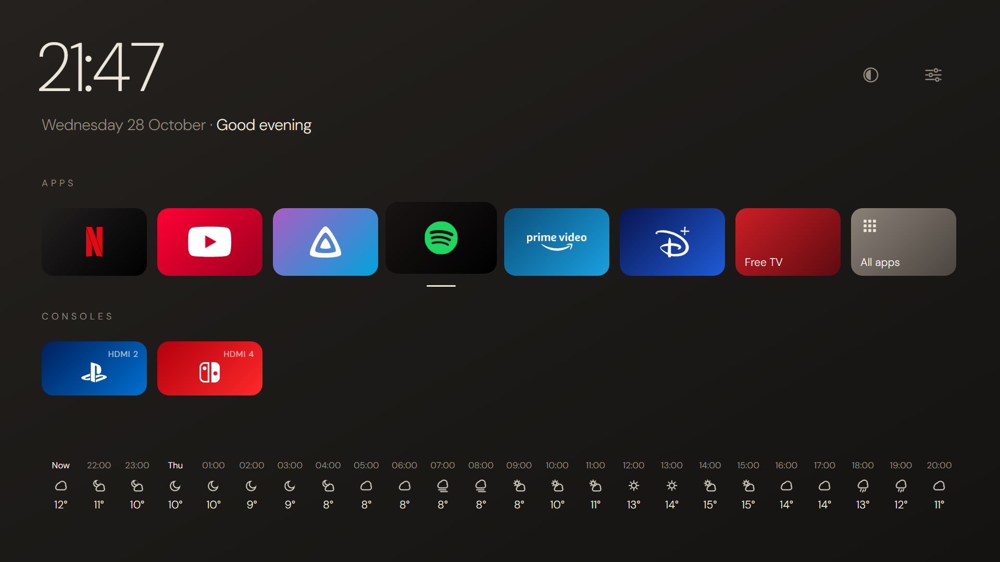
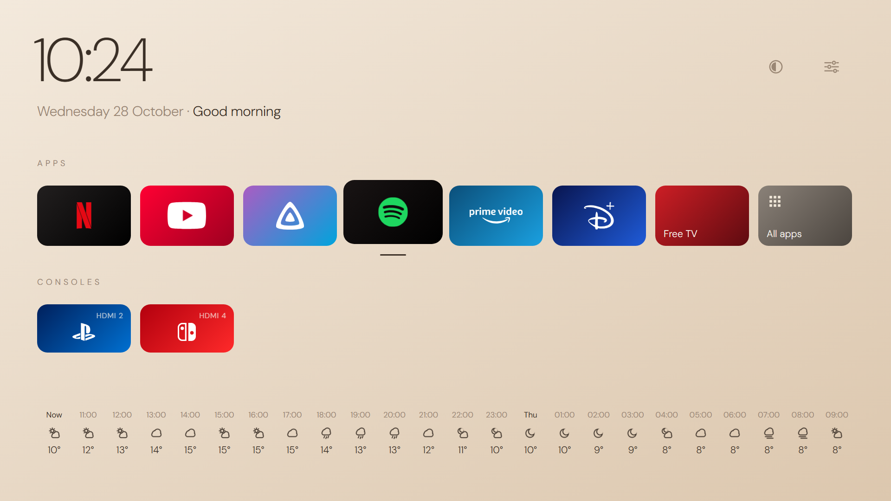
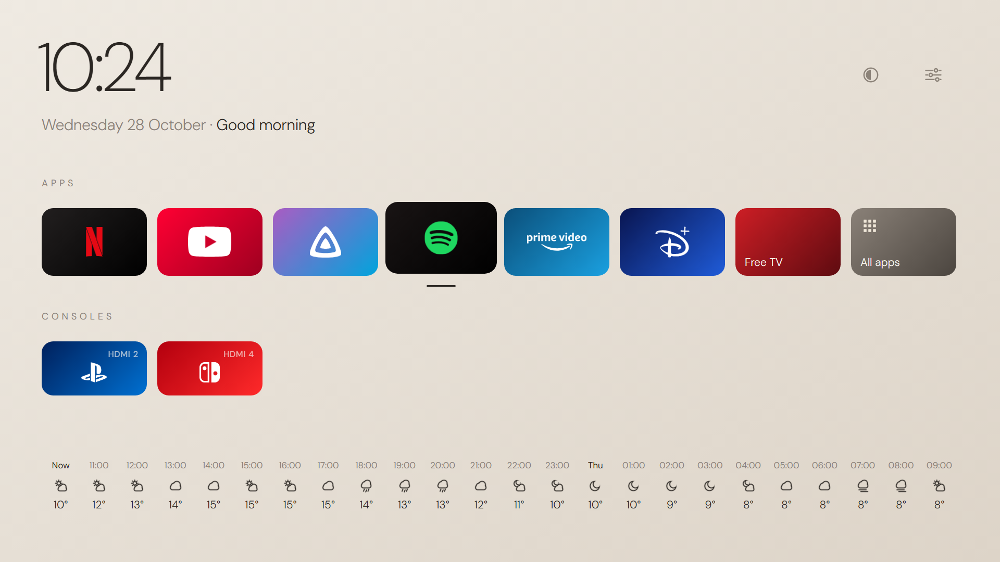
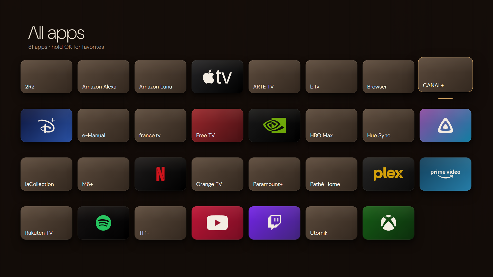
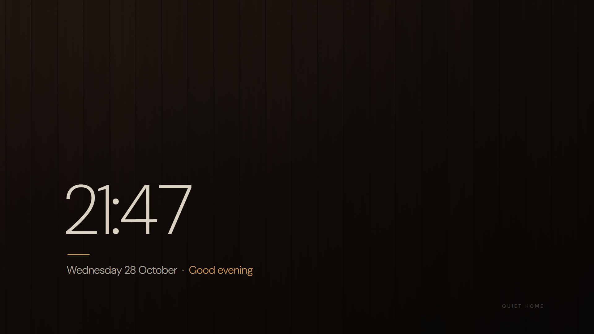
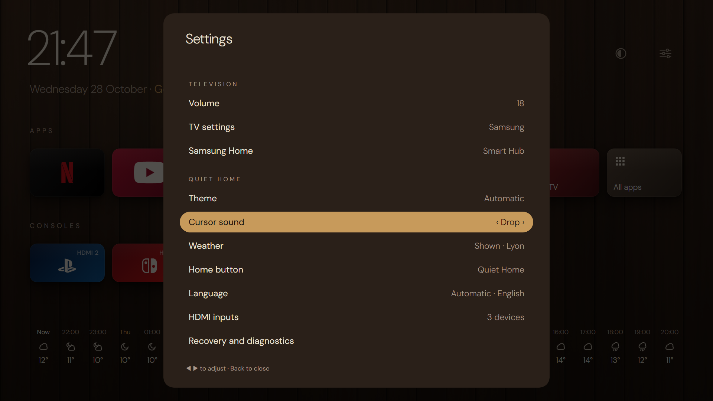
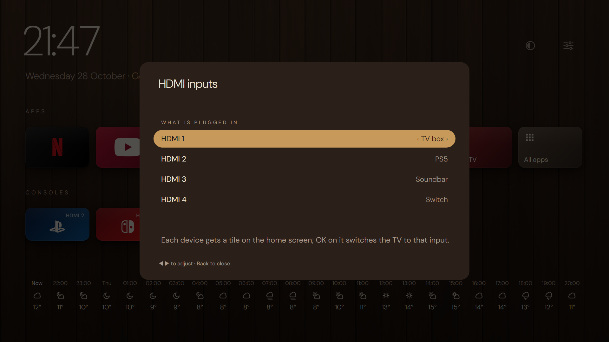
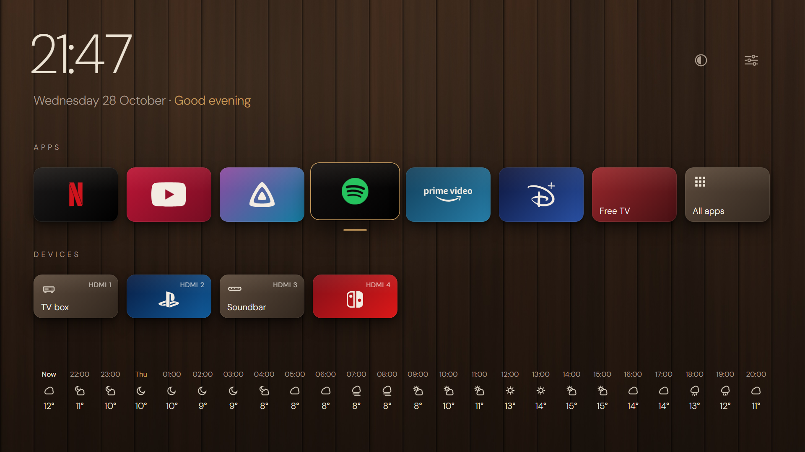

<p align="center"></p>

# Quiet Home for Samsung Tizen

[](https://github.com/Chamallaw/tizen-quiet-home/actions/workflows/ci.yml)

**English** · [Français](README.fr.md)

**A native, calm, ad-free home screen for Samsung TVs**, inspired by Japandi design: a dark wood wall, thin typography, the apps' official logos, consoles one click away. **The remote's Home button brings you straight back to it**, without root and without changing the TV's system.



> The images in this README are **renders** generated from the same positions, colors, logos and fonts as the app (`native/tools/make_preview_kuri.py`). They are not captures of the TV: Tizen does not allow screenshots in developer mode.

## What Quiet Home does

- **A clean home screen**:
  - your favorite apps with their official logos and colors (Netflix, YouTube, Jellyfin, Spotify, Prime Video, Disney+…);
  - your HDMI devices (consoles, TV box, soundbar…), set up in the app;
  - the time, the date and a greeting;
  - optionally, the weather for the next 24 hours, hour by hour.
- **Home button → Quiet Home**, from any app, in under a second. The selection goes back to the app you just left. **Two quick presses** open Samsung Home: Smart Hub and the TV settings are always within reach. See [docs/en/home-button.md](docs/en/home-button.md).
- **English and French**: the interface follows the TV's language, or the one you pick in Settings → *Language*.
- **Automatic theme**: Hinoki during the day, Kuri in the evening. It switches at sunrise and sunset.
- **5 themes** to choose from, remembered:
  - Kuri (walnut) and Smoked oak, with a 4K wood background;
  - Japandi, Sumi and Hinoki, as gradients.
- **"All apps"**: a grid of every installed app; holding OK on an app adds it to or removes it from favorites.
- **Screensaver** after 5 minutes: a large thin clock on veiled wood, moving slightly every minute to protect the panel.
- **Remote control**:
  - arrows, OK, hold OK for options;
  - keys 1 to 9 open the favorites;
  - animated transitions;
  - a soft sound each time the cursor moves (Drop, Wood or Kalimba), which can be turned off.
- **Settings in two parts**:
  - *Television*: volume, TV settings, Samsung Home;
  - *Quiet Home*: theme, cursor sound, weather, Home button, language, HDMI inputs (what is plugged into each port).

  Each setting shows its value and changes in place with ◀ ▶.
- **Recovery always available**: Samsung Home, TV settings, reset, diagnostics (HDMI and volume tests, key identification).

### The 5 themes

| Kuri · walnut (evening, default) | Smoked oak | Sumi |
|---|---|---|
|  |  |  |

| Hinoki (day, default) | Japandi |
|---|---|
|  |  |

### All apps, settings and screensaver

| All apps | Screensaver |
|---|---|
|  |  |

| Settings | HDMI inputs | TV box and soundbar |
|---|---|---|
|  |  |  |

## Principles

- **A regular app** (a `.tpk` signed with your own Samsung certificate), installed in developer mode. No root, no exploit, no rewriting of system settings.
- **Reversible**: uninstalling the app puts the TV back exactly as it was.
- **Nothing is sent to the Internet by default.** The only network traffic is the logs sent to the development PC, on the local network, and only while developer mode is on.
- **The weather is optional.** It is turned on only if you give a place ([docs/en/customize.md](docs/en/customize.md#weather)). Quiet Home then asks [Open-Meteo](https://open-meteo.com) once an hour, with that place's coordinates, without any account or identifier.

## Compatibility

| | |
|---|---|
| Tested on | **Samsung QE65QN700BTXXC** (Neo QLED 8K, 2022), Tizen 6.5 (API 9), armv7 |
| Probably compatible | Samsung TVs from 2020 onwards with the .NET runtime (Tizen 5.5+). **Not tested**: feedback is welcome. |
| Development PC | Windows (PowerShell scripts). Tizen Studio, .NET 8 SDK and Python 3. Chrome is only used to regenerate the images. |

The `sdb` shell of recent consumer TVs is closed (even `echo` is refused). Quiet Home does not use it: everything goes through installing the app and Tizen's public APIs.

## Install

Two ways:

1. **By hand**: follow [docs/en/install.md](docs/en/install.md) (about 30 minutes the first time).
2. **With a coding agent** (Claude Code, Codex…): open the repository, give it the prompt from [docs/en/agent.md](docs/en/agent.md), and do the few steps it cannot do yourself (Samsung account, firewall, remote control). The instructions for the agent are in [AGENTS.md](AGENTS.md).

In short, once the TV is in developer mode and the Samsung certificate is created:

```powershell
.\native\tools\tv-native.ps1 -TvIp <TV_IP> -Action deploy -CertProfile <YOUR_PROFILE>
```

## Documentation

| | |
|---|---|
| [docs/en/install.md](docs/en/install.md) | Step-by-step install, start at power-on, logs |
| [docs/en/agent.md](docs/en/agent.md) | Install and set up with a coding agent |
| [docs/en/home-button.md](docs/en/home-button.md) | The Home button shortcut: how it works, limits, turning it off |
| [docs/en/customize.md](docs/en/customize.md) | Language, favorites, HDMI devices, logos, themes, weather, backgrounds, fonts |
| [docs/en/troubleshooting.md](docs/en/troubleshooting.md) | Troubleshooting and going back to the original state |
| [CHANGELOG.md](CHANGELOG.md) | Release notes (in French) |
| [native/README.md](native/README.md) | Technical reference: architecture, test plan (in French) |
| [docs/research/](docs/research/) | Initial research (quiet-tizen, Fresh Home, Skylight…) |
| [web/](web/) | First Web App prototype (historical) |

The code comments, the technical reference and the agent instructions are written in French.

## Layout

```
native/
  src/QuietHome.Core/      pure logic (config, catalog, focus, themes, sun, weather, Home button, languages), tested on PC
  src/QuietHome.Launcher/  NUI app: home screen, grid, screensaver, Tizen platform
  tests/                   xUnit tests (dotnet test)
  res/                     logos, pictograms, 4K backgrounds, fonts (ready to use)
  tools/                   build/sign/install, resource and render generation
tools/tv-fiche.ps1         technical sheet of your TV (read-only)
docs/                      documentation (French; English in docs/en/) and images
web/                       Web App prototype (historical)
```

## Credits and inspiration

- [jss8649/quiet-tizen](https://github.com/jss8649/quiet-tizen): the idea of a native .NET/NUI launcher and the native mechanisms (sources, volume, settings).
- [NelsonEU/arn0-tv](https://github.com/NelsonEU/arn0-tv): the logo sources and brand colors.
- [SaudSatopay/skylight-tizen](https://github.com/SaudSatopay/skylight-tizen): the idea of coming back to the launcher by watching the screen rather than intercepting the key.
- [Open-Meteo](https://open-meteo.com): the weather forecasts (data under the CC BY 4.0 license).
- [KSWORK2001/fresh-home](https://github.com/KSWORK2001/fresh-home), [gus-cardoso/quiet-tizen-qn90b](https://github.com/gus-cardoso/quiet-tizen-qn90b), [simbasjungles/free-my-tv](https://github.com/simbasjungles/free-my-tv).

## License

Code under the [MIT](LICENSE) license. Logos, fonts and other third-party elements: see [NOTICE.md](NOTICE.md). Brand names and logos belong to their owners. This project is not affiliated with Samsung or with the services mentioned.
